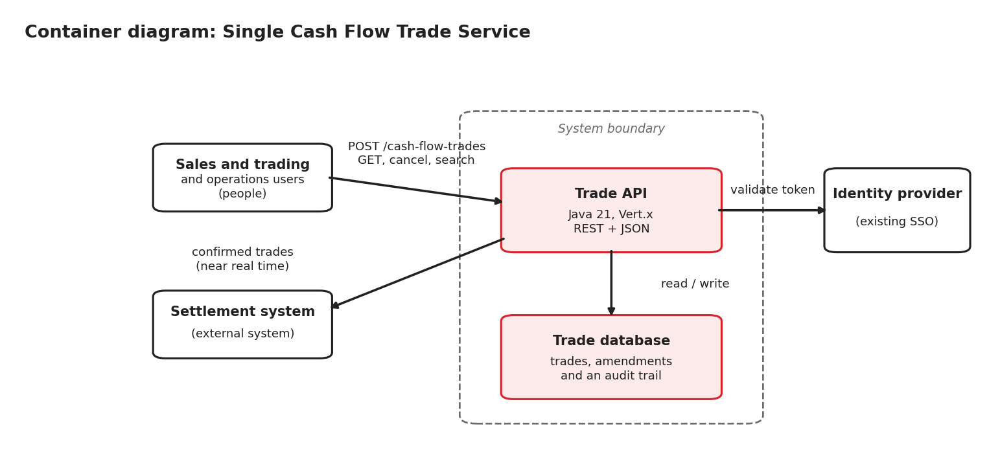

# System Design and PRD

**Session Time:** 55 minutes (5 welcome and setup check, 12 guided demo, 35 lab including tool setup, 3 wrap-up)

---

## Prerequisites

* Java proficiency, including records and enums, and reading a JUnit test
* Basic exposure to an AI coding assistant such as GitHub Copilot Chat
* No prior knowledge of C4, OpenAPI or Vert.x is needed

---

## Table of Contents

1. [What You Will Learn](#what-you-will-learn)
2. [Scope One Service at a Time](#scope-one-service-at-a-time)
3. [Design Is a Conversation](#design-is-a-conversation)
4. [Find the Gaps Before You Build](#find-the-gaps-before-you-build)
5. [From Requirements to a Contract](#from-requirements-to-a-contract)
6. [Check the Contract Against the Requirements](#check-the-contract-against-the-requirements)
7. [Wrap-Up Reflection](#wrap-up-reflection)
8. [Resources](#resources)

---

## Learning Objectives

By the end of this module, you'll be able to:

- Scope a design request to a unit of work an AI assistant can reason about, including in a codebase it handles badly
- Use an assistant to compare architecture options and draft a C4 outline and a design document
- Use an assistant to find the gaps and ambiguities in a product requirements document (PRD)
- Generate Java records from an OpenAPI specification and check them with a contract test (writing the spec and Vert.x route stubs yourself is bonus work)
- Verify AI-generated artifacts against each other and against the requirements

---

## What You Will Learn

**The challenge:** a new microservice PRD lands with a tight deadline. How do you reach a defensible architecture quickly, and how do you know the assistant's answer is not just confident?

Today's work is one level above writing code. You will use an assistant as a thinking partner for design decisions, then turn the result into artifacts a team can build against: a specification, data transfer objects, route stubs and a test that keeps them honest.

Here is the service you will design. Sales and operations create and track a single cash flow precious-metals trade; confirmed trades go to the settlement system.



---

## Scope One Service at a Time

AI assistants are strongest when the whole problem fits in the conversation. They struggle on very large codebases, so everything in this course is scoped to **one service-sized slice**, and that is a habit worth keeping at work. A small Vert.x microservice is a much better target than a very large monolith.

| Do | Why |
|---|---|
| Attach only the files that matter to this question | The assistant cannot weigh what it was never shown, and extra files dilute what it was |
| State the constraints in the prompt | The assistant will otherwise invent plausible ones |
| Write your team's conventions down once | A short rules file beats re-explaining in every chat |

A conventions file does not need to be long. Rules that are short and specific work best. See `lab/copilot-instructions.example.md` for a complete example:

```text
- Java 21. Prefer records for DTOs. No Lombok.
- HTTP layer is Vert.x 4. Do not generate Spring annotations.
- Money and quantities are BigDecimal, never double.
- Never block the Vert.x event loop; wrap blocking calls in executeBlocking.
- Secrets come from environment variables. Never hard-code a credential.
- Tests use JUnit 5 and Mockito. Every bug fix comes with a failing test first.
```

In this course, a file like this is **already installed** in every lab folder as `.github/copilot-instructions.md`, and Copilot reads it automatically when that lab folder is open in VS Code. `lab/copilot-instructions.example.md` is for reference only: you do not need to copy it anywhere. At work, check your organisation's Copilot settings for the exact file name and whether it is enabled.

---

## Design Is a Conversation

A weak request gets a generic answer. A strong request gives the assistant something to push against and asks it to push back.

| Weak | Strong |
|---|---|
| Design a cash flow trade service. | Compare Vert.x and Spring Boot for the HTTP layer of this service, give the three trade-offs that matter most for a team whose biggest recurring pain is patching CVEs, recommend one, and tell me what in my PRD you would push back on first. |


> **Prompt-along.**
> 
> Attach `lab/prd/single-cash-flow-prd.md` and the prompt file `lab/prompts/01-tradeoffs.md`. 
>Read the answer as a reviewer would:
> - Which trade-off would you have missed without the assistant?
> - Which statement is a confident guess about your organisation, not about your PRD?
> - What did it assume that nobody told it?


Then ask for the artifacts: `lab/prompts/02-c4-and-design-doc.md`. A C4 container outline names people, the service, its database and the external systems, and labels what flows on each arrow. Check yours against the diagram above:

- Are there only containers, with no classes?
- Is everything the service does not own shown as an external box?
- Is every arrow labelled?

---

## Find the Gaps Before You Build

A PRD that says "Open questions: none recorded" is a warning sign. The cheapest time to find an ambiguity is before anyone has written code against it.


>**Prompt-along.** 
>
>Attach the PRD and `lab/prompts/03-find-the-gaps.md`. The prompt asks the assistant to act as a skeptical senior engineer and, for each gap, give the question to ask and a sensible default.


Categories worth prompting for:

| Category | Example question for the cash flow service |
|---|---|
| Identifiers | What does a trade id look like, and who creates it? |
| Units and precision | "Ounces": troy, or the ordinary kind? Grams for kilo bars? How many decimals? |
| Calendars | "A valid business day": whose calendar, and what about holidays? |
| Duplicates | How is "the same trade twice" recognized: a key, or a match on the fields? |
| Who can do what | Can anyone cancel a trade? Until when? |
| Targets | How fast is "quickly", and how available is "highly available"? |
| Delivery | What does "near real time" to the settlement system mean, and what if it is down? |

In the lab you will pick the **three** gaps that matter most and write your defaults down as **assumptions**. A design built on written assumptions can be corrected; one built on unspoken assumptions cannot.

---

## From Requirements to a Contract

A contract is something both sides can check. Three artifacts make one:

| Artifact | What it is | Why it matters |
|---|---|---|
| OpenAPI specification | A machine-readable description of every endpoint | Callers and tests are written against it |
| Java records | Immutable data carriers that validate in their constructor | Bad input stops at the door |
| Vert.x route stubs | Routes that exist but return HTTP 501 | The shape is real before the logic is |

Here is a record written the careful way. Compare it with what your assistant generates:

```java
public record CreateCashFlowTradeRequest(String clientId, Metal metal, BigDecimal quantityTroyOz,
                                         BigDecimal pricePerTroyOz, String currency, LocalDate settlementDate) {
    public CreateCashFlowTradeRequest {
        if (clientId == null || clientId.isBlank()) throw new IllegalArgumentException("clientId is required");
        if (quantityTroyOz == null || quantityTroyOz.signum() <= 0)
            throw new IllegalArgumentException("quantityTroyOz must be greater than 0");
        // ... price, currency and settlement date are validated the same way
    }
}
```

**Review checklist: what assistants often get wrong**

| Look for | Why it is a problem |
|---|---|
| `double` for money or quantity | Binary floating point cannot represent 0.1 exactly. Use `BigDecimal` |
| Spring annotations in a Vert.x service | The assistant defaulted to the framework it has seen most. This service's HTTP layer is Vert.x |
| No validation in the record | An empty id or a negative quantity reaches your business logic |
| Enum or field names that differ from the spec | The code and the contract quietly drift apart |
| A route that returns 200 and does nothing | A stub must fail loudly (501) so nobody mistakes it for working code |

---

## Check the Contract Against the Requirements

Generated artifacts agree with each other only by luck. A small test makes that agreement a fact. `OpenApiContractTest` reads your `openapi.yaml` and looks up your records by name, then checks that every record component appears in the spec and that the enums match:

```java
for (RecordComponent c : record.getRecordComponents()) {
    assertTrue(block.contains("        " + c.getName() + ":"), schema + " is missing property " + c.getName());
}
```

If someone renames a field in one place and not the other, this test fails. That is the point: a failing test now is cheaper than a broken integration later.

**Think about it:** the test proves the spec and the records agree. Does it prove either of them is *right*? What would?

---

## In the Lab

**PRD-to-Contract Lab.** The lab has a **core task of about 35 minutes** and a **bonus section** for anyone who finishes early or wants to keep going later. It starts from its own clean folder, so you do not need anything from an earlier module. If you get stuck, every step has a `catch-up` command that copies in finished code so you can keep going.

- **Already built for you:** `openapi.yaml`, the OpenAPI specification, so you can spend your time on the records and the contract check.
- **Your core task:** sign in to GitHub Copilot, pick the three most important PRD gaps and write your defaults, generate the five Java records from the provided spec, then run the contract check and break it on purpose.
- **Bonus:** the trade-offs and C4 prompts, writing your own OpenAPI spec (saved to `bonus/`), and Vert.x route stubs that return 501.

---

## Wrap-Up Reflection

- Which part of the assistant's design output would you have caught without it, and which would you have missed?
- Which gap in the PRD would have cost the most if you had discovered it in week three?
- What is one check you would add to a pull request that contains AI-generated artifacts?

---

## Resources

- Eclipse Vert.x documentation: <https://vertx.io/docs/>
- OpenAPI Specification 3.0.3: <https://spec.openapis.org/oas/v3.0.3>
- Java records: <https://docs.oracle.com/en/java/javase/21/language/records.html>
- The C4 model for software architecture: <https://c4model.com/>
- JUnit 5 user guide: <https://junit.org/junit5/docs/current/user-guide/>
