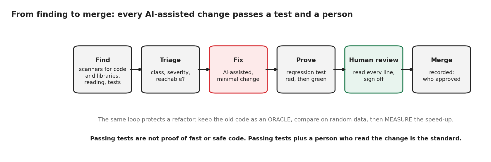

# Performance and Security

**Session Time:** 55 minutes (2 framing, 15 guided refactor, 35 lab, 3 wrap-up)

---

## Prerequisites

* Modules 1 and 2 complete, or equivalent comfort reviewing AI-generated code
* Java proficiency, including streams, JUnit 5 and Maven
* No security background is needed. The ideas are introduced as you go.

---

## Table of Contents

1. [What You Will Learn](#what-you-will-learn)
2. [Passing Tests Is Not Enough](#passing-tests-is-not-enough)
3. [Refactor With a Safety Net](#refactor-with-a-safety-net)
4. [Measure Before You Claim](#measure-before-you-claim)
5. [Findings Come From Different Places](#findings-come-from-different-places)
6. [Fix and Prove It](#fix-and-prove-it)
7. [Governance and Human Review](#governance-and-human-review)
8. [Wrap-Up Reflection](#wrap-up-reflection)
9. [Resources](#resources)

---

## Learning Objectives

By the end of this module, you'll be able to:

- Use tests and a frozen copy of the original code to refactor with an AI assistant without changing behaviour
- Measure a performance change instead of assuming one
- Audit a codebase for vulnerabilities, credential leakage and vulnerable dependencies, and recognise what a scanner cannot see
- Fix a finding and prove the fix with a regression test
- Apply governance checks and a human review step to AI-generated changes

---

## What You Will Learn

**The challenge:** AI-generated code passes its tests, but it is slow, it leaks a credential, and it drags in a library with a famous vulnerability. What would an auditor say?

A green test suite tells you the code is correct for the cases you tested. It says nothing about whether the code is fast, safe, or reviewed. Today you will deal with each half: first making code faster without breaking it, then finding what is unsafe in code you have never seen. Patching known vulnerabilities is already a large share of many teams' week, so one of the findings is about dependencies.



---

## Passing Tests Is Not Enough

Think of three questions you can ask about any change, and notice that tests answer only the first.

| Question | Answered by |
|---|---|
| Does it do the right thing for the cases we thought of? | Your tests |
| Is it fast enough, and did the change make it faster or only look tidier? | A measurement |
| Is it safe, and did a person who understands the risk read it? | An audit and a human review |

The rest of the module is the second and third rows.

---

## Refactor With a Safety Net

Refactoring means changing how code is written without changing what it does. Assistants are good at it, which is exactly why it needs a net.

Two tools give you that net:

- **Hand-written behaviour tests** for the cases that matter. One of them hides a trap: a method that lists duplicate trade ids must list them in the order of their *first* occurrence. For the sequence A, B, B, A the answer is `[A, B]`. A tidy rewrite that adds an id when it sees it for the *second* time answers `[B, A]`, and every test that only checks "the right ids" still passes.
- **An oracle.** Keep a frozen copy of the original in `LegacyTradeReconciler`. A test then runs your refactor and the original on random data and demands identical answers.

Here is the method you will refactor. It is correct, and it is slow:

```java
public List<String> findDuplicateTradeIds(List<Trade> trades) {
    List<String> duplicates = new ArrayList<>();
    for (int i = 0; i < trades.size(); i++) {
        for (int j = i + 1; j < trades.size(); j++) {
            if (trades.get(i).tradeId().equals(trades.get(j).tradeId())) {
                if (!duplicates.contains(trades.get(i).tradeId())) {
                    duplicates.add(trades.get(i).tradeId());
                }
            }
        }
    }
    return duplicates;
}
```

> **Prompt-along.** 
>
> Attach `lab/refactor/.../TradeReconciler.java` and `lab/prompts/refactor.md`. The prompt asks the assistant to list the behaviours that could differ, so you know what to test before you trust the result.

---

## Measure Before You Claim

"It is cleaner" and "it is faster" are different claims. Measure the second one.

Real timings from the lab, using the reference refactor (one run; yours will differ):

| Method | Original | Refactored |
|---|---|---|
| `findDuplicateTradeIds` (8,000 trades) | 194.6 ms | 2.5 ms |
| `notionalByMetal` (400,000 trades) | 11.6 ms | 9.3 ms |
| `countByStatus` (400,000 trades) | 14.1 ms | 6.4 ms |

The first row is a better *algorithm*: one pass instead of a nested loop, roughly 80 times faster in this run. The other two are tidier code with differences of the size a stopwatch cannot trust, because a Java program's first timings include warm-up of the JVM. Do not let anyone claim the first result for the second kind of change. These are rough timings, not a rigorous benchmark. Use JMH when it matters.

A related trap is floating-point arithmetic: summing the same numbers in a different order can change the last digits of a `double`, so a refactor that reorders a sum may need a tolerance in its test, or `BigDecimal`.

---

## Findings Come From Different Places

Now the audit. A **finding** is a reason to worry about the code. Some findings are reported by a tool; some are found only by reading or by a test.

| Source | Good at | Misses |
|---|---|---|
| A code scanner (for example SonarQube) | Patterns in your own code: string-built SQL, hard-coded passwords | Anything it has no rule for |
| A dependency scanner (for example OWASP Dependency-Check or Trivy) | Known vulnerabilities in the libraries you declare | Your own code |
| Reading the code | Intent, data flow, what a value is *for* | Subtle bugs in large files |
| A regression test | Proving a specific behaviour is fixed, and keeps it fixed | Problems nobody wrote a test for |

The audit target, a small inventory module, has four findings:

| Finding | Where | Usually found by |
|---|---|---|
| SQL injection: a query built by string concatenation | `InventoryRepository` | A code scanner |
| Hard-coded credentials: a database password and an API key | `AppConfig` | A code scanner, but it may flag only the constant named like a password |
| Vulnerable dependencies: `log4j-core` 2.14.1 and `commons-text` 1.9 | `pom.xml` | A dependency scanner only |
| The full account number written to the log and the statement | `StatementExporter` | Usually **not** a scanner: a person reading, or a test |

The two libraries are well known: `log4j-core` 2.14.1 is the version behind the Log4Shell vulnerability (CVE-2021-44228) and `commons-text` 1.9 is behind Text4Shell (CVE-2022-42889). Confirm the identifiers and severities with your scanner's output, not from memory. In the lab, `scanner-report.md` shows the kind of output the scanners give. It is simulated for the course and labelled as such.

**Triage** means deciding what to fix first. Ask of every finding: what class is it, how severe, and is it reachable from a real request? A vulnerable library the code never calls is still worth fixing, but you can prove it is unreachable with one command:

```bash
grep -rn "org.apache.logging\|org.apache.commons.text" src/main
```

If that finds nothing, both libraries are declared and unused. The cheapest fix is then to **remove them**, which removes the exposure entirely and needs no upgrade. A team that spends much of its week on CVEs will want that question asked before every upgrade.

---

## Fix and Prove It

A fix is not done until a test says it is. In the lab the regression tests describe correct behaviour, so they start **red**. Typical fixes:

| Finding | OWASP Top 10:2025 | Fix |
|---|---|---|
| String-built SQL | A05 Injection | A `PreparedStatement` with a bound parameter |
| Hard-coded secret | A07 Authentication Failures | Read it from the environment, and fail fast when it is missing |
| Vulnerable but unused dependency | A03 Software Supply Chain Failures | Remove it from `pom.xml` |
| Vulnerable and used dependency | A03 Software Supply Chain Failures | Upgrade to a patched version your scanner confirms |
| Account number in logs | A09 Security Logging and Alerting Failures | Mask it everywhere it is written |

Fix one finding at a time. After each, run the tests, and read the diff yourself before you move on.

The OWASP column uses the 2025 list. It is for discussion, not a rule: some findings fit more than one category (a hard-coded secret is also a configuration problem, A02 Security Misconfiguration). If you know the 2021 list, note the renumbering: Injection moved from A03 to A05, and A06 Vulnerable and Outdated Components grew into A03 Software Supply Chain Failures. Confirm the mapping against the version of the list your organisation uses.

---

## Governance and Human Review

Governance is the part that turns "the assistant fixed it" into "we can defend this change". Four questions before an AI-assisted change merges:

- Did a person, not the assistant, read every changed line?
- Does any fix change behaviour that a client or downstream system depends on?
- Is any sensitive data (a credential, a full account number) still written to a log, a file or a response?
- Who approved, and where is that recorded?

If any answer is "I don't know", the change is not ready, however green the tests are.

---

## In the Lab

**Refactor and Audit Lab.** The lab has a **core task of about 35 minutes** and a **bonus section** for anyone who finishes early or wants to keep going later. It starts from its own clean folder, so you do not need anything from an earlier module. If you get stuck, every step has a `catch-up` command that copies in finished code so you can keep going.

- **Already built for you:** a simulated `scanner-report.md` (no live scanner is needed) and a findings table with the four findings listed.
- **Your core task:** refactor `TradeReconciler` with your assistant until the safety net and the performance test pass, run the benchmark, then fix two findings (SQL injection and account-number masking) and prove each with its regression test.
- **Bonus:** the hard-coded secrets fix, removing the vulnerable libraries, the governance questions, and writing one more regression test.

---

## Wrap-Up Reflection

- Which finding would you have missed without reading the code, and what does that say about scanners?
- Your refactor is cleaner but no faster. What do you write in the pull request?
- A vulnerable library is declared but unused. Do you upgrade it, remove it, or both, and who decides?

---

## Resources

- OWASP Top 10:2025: <https://owasp.org/Top10/2025/>
- OWASP Dependency-Check: <https://owasp.org/www-project-dependency-check/>
- SonarQube documentation: <https://docs.sonarsource.com/sonarqube/latest/>
- JMH, the Java Microbenchmark Harness: <https://github.com/openjdk/jmh>
- Mockito: <https://site.mockito.org/>
