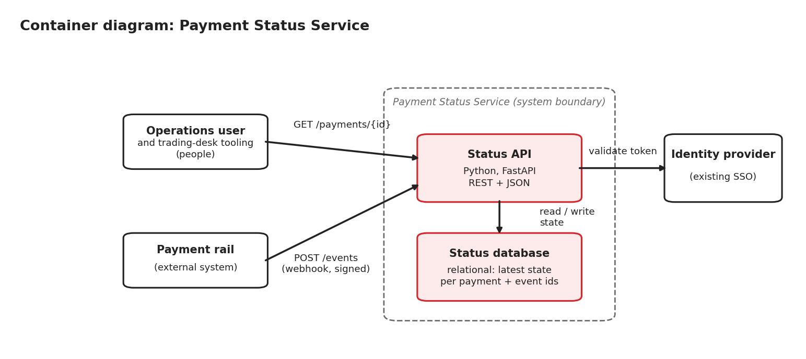

# AI-Assisted System Design and PRD Generation

**Session Time:** 55 minutes (5 welcome and setup check, 12 guided demo, 35 lab including tool setup, 3 wrap-up)

---

## Prerequisites

* Python proficiency, including reading a FastAPI or Flask route and a dataclass
* Basic exposure to an AI coding assistant such as GitHub Copilot Chat
* No prior knowledge of C4, OpenAPI or Pydantic is needed

---

## Table of Contents

1. [What You Will Learn](#what-you-will-learn)
2. [Scope One Service at a Time](#scope-one-service-at-a-time)
3. [Design Is a Conversation](#design-is-a-conversation)
4. [Find the Gaps Before You Build](#find-the-gaps-before-you-build)
5. [From Requirements to a Contract](#from-requirements-to-a-contract)
6. [Check the Contract Against the Requirements](#check-the-contract-against-the-requirements)
7. [In the Lab](#in-the-lab)
8. [Wrap-Up Reflection](#wrap-up-reflection)
9. [Resources](#resources)

---

## Learning Objectives

By the end of this module, you'll be able to:

- Scope a design request to a unit of work an AI assistant can reason about
- Use an assistant to compare architecture options and draft a C4 outline and a design document
- Use an assistant to find the gaps and ambiguities in a product requirements document (PRD)
- Generate Pydantic models from an OpenAPI specification and check them with a contract test (writing the spec, FastAPI stubs and test stubs yourself is bonus work)
- Verify AI-generated artifacts against each other and against the requirements

---

## What You Will Learn

**The challenge:** a new Python payments-service PRD lands with a tight deadline. How do you reach a defensible architecture quickly, and how do you know the assistant's answer is not just confident?

Today's work is one level above writing code. You will use an assistant as a thinking partner for design decisions, then turn the result into artifacts a team can build against: a specification, data models, route stubs and tests.

Here is the service you will design. It keeps the latest state of each outbound payment, fed by notifications from the payment rail.



---

## Scope One Service at a Time

AI assistants are strongest when the whole problem fits in the conversation. Everything in this course is scoped to **one service-sized slice**, and that is a habit worth keeping at work.

| Do | Why |
|---|---|
| Attach only the files that matter to this question | The assistant cannot weigh what it was never shown, and extra files dilute what it was |
| State the constraints in the prompt | The assistant will otherwise invent plausible ones |
| Write your team's conventions down once | A short rules file beats re-explaining in every chat |

A conventions file does not need to be long. Rules that are short and specific work best:

```text
- Python 3.12. Type hints on public functions.
- Money and quantities use Decimal, never float.
- Datetimes are timezone-aware and in UTC.
- Secrets come from environment variables. Never hard-code a credential.
- Tests use pytest. Every bug fix starts with a failing test.
```

In this course, a file like this is **already installed** in every lab folder as `.github/copilot-instructions.md`, and Copilot reads it automatically when that lab folder is open in VS Code. You do not need to copy it anywhere. At work, check your organisation's Copilot settings for the exact file name and whether it is enabled.

---

## Design Is a Conversation

A weak request gets a generic answer. A strong request gives the assistant something to push against and asks it to push back.

| Weak | Strong |
|---|---|
| Design a payment status service. | Compare two designs for storing and serving payment status, give the three trade-offs that matter for a bank, recommend one, and tell me what in my PRD you would push back on first. |

>**Prompt-along.**
>
>Attach `lab/prd/payment-status-prd.md` and the prompt file `lab/prompts/01-tradeoffs.md`. Read the answer as a reviewer would:

- Which trade-off would you have missed without the assistant?
- Which statement is a confident guess about HSBC, not about your PRD?
- What did it assume that nobody told it?

Then ask for the artifacts: `lab/prompts/02-c4-and-design-doc.md`. A C4 container outline names people, the service, its database and the external systems, and labels what flows on each arrow. Check yours against the diagram above:

- Are there only containers, with no classes?
- Is everything the service does not own shown as an external box?
- Is every arrow labelled?

---

## Find the Gaps Before You Build

A PRD that says "Open questions: none recorded" is a warning sign. The cheapest time to find an ambiguity is before anyone has written code against it.

>**Prompt-along.**
>
>Attach the PRD and `lab/prompts/03-find-the-gaps.md`. The prompt asks the assistant to act as a skeptical senior engineer and, for each gap, give the question to ask and a sensible default.

Categories worth prompting for:

| Category | Example question for the payment service |
|---|---|
| Identifiers | What does a payment id look like, and who creates it? |
| Allowed changes | Can a settled payment ever become failed? |
| Duplicates and order | What if the same notification arrives twice, or an older one arrives late? |
| Who can call what | Who may read a payment's status? |
| Time | Which time zone and format do timestamps use? |
| Targets | How fast is "quickly", and how available is "highly available"? |
| Security | How does the service know a notification really came from the rail? |

In the lab you will pick the **three** gaps that matter most and write your defaults down as **assumptions**. A design built on written assumptions can be corrected; one built on unspoken assumptions cannot.

---

## From Requirements to a Contract

A contract is something both sides can check. Three artifacts make one:

| Artifact | What it is | Why it matters |
|---|---|---|
| OpenAPI specification | A machine-readable description of every endpoint | Callers and tests are written against it |
| Pydantic models | Python classes that validate data on the way in | Bad input stops at the door |
| FastAPI route stubs | Routes that exist but return HTTP 501 | The shape is real before the logic is |

Here is a model written the careful way. Compare it with what your assistant generates:

```python
from pydantic import AwareDatetime, BaseModel, Field


class PaymentEvent(BaseModel):
    event_id: str = Field(min_length=1, max_length=64)
    payment_id: str = Field(min_length=1, max_length=64)
    state: PaymentState                     # an Enum: submitted, settled, failed
    occurred_at: AwareDatetime              # must carry a timezone
```

**Review checklist: what assistants often get wrong**

| Look for | Why it is a problem |
|---|---|
| A plain `datetime` for timestamps | It accepts values with no time zone, so two systems can disagree by hours |
| Money as `float` | Binary floating point cannot represent 0.1 exactly. Use `Decimal` |
| No validation | An empty id or a made-up state reaches your business logic |
| State names that differ from the spec | The model and the contract quietly drift apart |
| A route that returns 200 and does nothing | A stub must fail loudly (501) so nobody mistakes it for working code |

---

## Check the Contract Against the Requirements

Generated artifacts agree with each other only by luck. A small test makes that agreement a fact. This one reads your `openapi.yaml` and your `models.py` and compares them:

```python
def test_model_fields_match_the_schema(spec, models, name):
    schema_props = set(schema(spec, name)["properties"])
    model_fields = set(getattr(models, name).model_fields)
    assert model_fields == schema_props
```

If someone renames a field in one file and not the other, this test fails. That is the point: a failing test now is cheaper than a broken integration later.

**Think about it:** the test proves the spec and the models agree. Does it prove either of them is *right*? What would?

---

## In the Lab

**PRD-to-Contract Lab.** The lab has a **core task of about 35 minutes** and a **bonus section** for anyone who finishes early or wants to keep going later. It starts from its own clean folder, so you do not need anything from an earlier module. If you get stuck, every step has a `catch-up` command that copies in finished code so you can keep going.

- **Already built for you:** `openapi.yaml`, the OpenAPI specification, so you can spend your time on the models and the contract check.
- **Your core task:** sign in to GitHub Copilot, pick the three most important PRD gaps and write your defaults, generate `models.py` from the provided spec, then run the contract check and break it on purpose.
- **Bonus:** the trade-offs and C4 prompts, writing your own OpenAPI spec (saved to `bonus/`), and FastAPI and test stubs that return 501.

---

## Wrap-Up Reflection

- Which part of the assistant's design output would you have caught without it, and which would you have missed?
- Which gap in the PRD would have cost the most if you had discovered it in week three?
- What is one check you would add to a pull request that contains AI-generated artifacts?

---

## Resources

- FastAPI documentation: <https://fastapi.tiangolo.com/>
- Pydantic documentation: <https://docs.pydantic.dev/latest/>
- OpenAPI Specification 3.0.3: <https://spec.openapis.org/oas/v3.0.3>
- The C4 model for software architecture: <https://c4model.com/>
- pytest documentation: <https://docs.pytest.org/>
