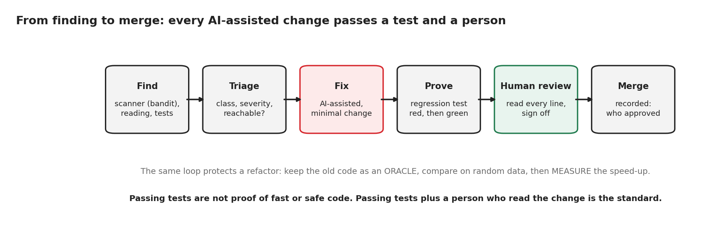

# Performance, Security and Governance in Python

**Session Time:** 55 minutes (2 framing, 15 guided refactor, 35 lab, 3 wrap-up)

---

## Prerequisites

* Modules 1 and 2 complete, or equivalent comfort reviewing AI-generated code
* Python proficiency, including `pytest` and `collections`
* No security background is needed. The ideas are introduced as you go.

---

## Table of Contents

1. [What You Will Learn](#what-you-will-learn)
2. [Passing Tests Is Not Enough](#passing-tests-is-not-enough)
3. [Refactor With a Safety Net](#refactor-with-a-safety-net)
4. [Measure Before You Claim](#measure-before-you-claim)
5. [Findings Come From Different Places](#findings-come-from-different-places)
6. [Fix and Prove It](#fix-and-prove-it)
7. [Governance and Human Review](#governance-and-human-review)
8. [In the Lab](#in-the-lab)
9. [Wrap-Up Reflection](#wrap-up-reflection)
10. [Resources](#resources)

---

## Learning Objectives

By the end of this module, you'll be able to:

- Use tests and a frozen copy of the original code to refactor with an AI assistant without changing behaviour
- Measure a performance change instead of assuming one
- Audit a codebase for vulnerabilities and credential leakage, and recognise what a scanner cannot see
- Fix a finding and prove the fix with a regression test
- Apply governance checks and a human review step to AI-generated changes

---

## What You Will Learn

**The challenge:** AI-generated code passes its tests, but it is slow and it leaks a credential. What would an auditor say?

A green test suite tells you the code is correct for the cases you tested. It says nothing about whether the code is fast, safe, or reviewed. Today you will deal with each half: first making code faster without breaking it, then finding what is unsafe in code you have never seen.



---

## Passing Tests Is Not Enough

Think of three questions you can ask about any change, and notice that tests answer only the first.

| Question | Answered by |
|---|---|
| Does it do the right thing for the cases we thought of? | Your tests |
| Is it fast enough, and did the change make it faster or only look tidier? | A measurement |
| Is it safe, and did a person who understands the risk read it? | An audit and a human review |

The rest of the module is the second and third rows.

---

## Refactor With a Safety Net

Refactoring means changing how code is written without changing what it does. Assistants are good at it, which is exactly why it needs a net.

Two tools give you that net:

- **Hand-written behaviour tests** for the cases that matter. One of them hides a trap: a function that lists duplicate ids must list them in the order of their *first* occurrence. For the sequence A, B, B, A the answer is `['A', 'B']`. A tidy rewrite that appends an id when it sees it for the *second* time answers `['B', 'A']`, and every test that only checks "the right ids" still passes.
- **An oracle.** Keep a frozen copy of the original in `tests/legacy_reconciler.py`. A test then runs your refactor and the original on random data and demands identical answers.

Here is the function you will refactor. It is correct, and it is slow:

```python
def find_duplicate_ids(transactions):
    duplicates = []
    for i in range(len(transactions)):
        for j in range(i + 1, len(transactions)):
            if transactions[i].txn_id == transactions[j].txn_id:
                if transactions[i].txn_id not in duplicates:
                    duplicates.append(transactions[i].txn_id)
    return duplicates
```

>**Prompt-along.**
>
>Attach `lab/reconciler.py` and `lab/prompts/refactor.md`. The prompt asks the assistant to list the behaviours that could differ, so you know what to test before you trust the result.

---

## Measure Before You Claim

"It is cleaner" and "it is faster" are different claims. Measure the second one.

Real timings from the lab, using the reference refactor:

| Function | Original | Refactored | Speed-up |
|---|---|---|---|
| `find_duplicate_ids` (5,000 transactions) | 520.6 ms | 0.4 ms | about 1,300 times |
| `total_by_currency` (400,000 transactions) | 46.5 ms | 42.8 ms | about 1.1 times |
| `count_by_status` (400,000 transactions) | 32.3 ms | 28.0 ms | about 1.2 times |

The first row is a better *algorithm*: one pass instead of a nested loop. The other two are tidier *code* with almost no change in speed. Do not let anyone claim the first result for the second kind of change.

These are rough stopwatch timings, not a rigorous benchmark. Use `timeit` or a profiler when it matters, and expect your numbers to differ.

Money in this lab is `Decimal`, not `float`, so sums are exact and tests can demand equality without a tolerance.

---

## Findings Come From Different Places

Now the audit. A **finding** is a reason to worry about the code. Some findings are reported by a tool; some are found only by reading or by a test.

| Source | Good at | Misses |
|---|---|---|
| A static scanner such as `bandit` | Known patterns: weak hashes, string-built SQL, unsafe deserialisation | Anything it has no rule for |
| Reading the code | Intent, data flow, what a value is *for* | Subtle bugs in large files |
| A regression test | Proving a specific behaviour is fixed, and keeps it fixed | Problems nobody wrote a test for |

On the lab's audit target, `bandit` reports five issues:

| Rule | Finding | Severity |
|---|---|---|
| B324 | Weak MD5 hash used for passwords | High |
| B608 | SQL built by string concatenation | Medium |
| B301 | `pickle.loads` on data from outside | Medium |
| B105 | A hard-coded password string | Low |
| B403 | The `pickle` module is imported | Low |

What it does **not** report: the hard-coded `PRICING_API_KEY` (its rule looks for names like `password`, not `key`), and the full account number written to the logs. You will find those by reading.

**Triage** means deciding what to fix first. Ask of every finding: what class is it, how severe, and is it reachable from a real request? A weakness in code nobody calls still gets fixed, but it ranks below one on a public path.

---

## Fix and Prove It

A fix is not done until a test says it is. In the lab the security tests describe correct behaviour, so they start **red**. Typical fixes:

| Finding | OWASP Top 10:2025 | Fix |
|---|---|---|
| String-built SQL | A05 Injection | A parameterised query: `conn.execute(sql, (customer_id,))` |
| Hard-coded secret | A07 Authentication Failures | Read it from the environment, and fail fast when it is missing |
| `pickle` on outside data | A08 Software or Data Integrity Failures | JSON, which can describe values but cannot run code |
| MD5 for passwords | A04 Cryptographic Failures | A salted, slow, memory-hard hash such as `hashlib.scrypt` |
| Account number in logs | A09 Security Logging and Alerting Failures | Mask it everywhere it is written |

Fix one finding at a time. After each, run the tests, and read the diff yourself before you move on.

The OWASP column uses the 2025 list. It is for discussion, not a rule: some findings fit more than one category (a hard-coded secret is also a configuration problem, A02 Security Misconfiguration). If you know the 2021 list, note the renumbering: Injection moved from A03 to A05, and Cryptographic Failures from A02 to A04. Confirm the mapping against the version of the list your organisation uses.

---

## Governance and Human Review

Governance is the part that turns "the assistant fixed it" into "we can defend this change". Four questions before an AI-assisted change merges:

- Did a person, not the assistant, read every changed line?
- Does any fix change behaviour that a client or downstream system depends on?
- Is any sensitive data (a credential, a full account number) still written to a log, a file or a response?
- Who approved, and where is that recorded?

If any answer is "I don't know", the change is not ready, however green the tests are.

---

## In the Lab

**Refactor and Audit Lab.** The lab has a **core task of about 35 minutes** and a **bonus section** for anyone who finishes early or wants to keep going later. It starts from its own clean folder, so you do not need anything from an earlier module. If you get stuck, every step has a `catch-up` command that copies in finished code so you can keep going.

- **Already built for you:** a findings table with the five findings listed, and short scripts for every test, scan and benchmark.
- **Your core task:** refactor `reconciler.py` with your assistant until the safety net and the performance test pass, run the benchmark, run `bandit`, then fix two findings (SQL injection and account-number masking) and prove each with its tests.
- **Bonus:** the hard-coded secrets, unsafe `pickle` and weak password-hashing fixes, a clean `bandit` run, and the governance questions.

---

## Wrap-Up Reflection

- Which finding would you have missed without reading the code, and what does that say about scanners?
- Your refactor is cleaner but no faster. What do you write in the pull request?
- Which of today's fixes would you merge on a Friday afternoon, and which would you not?

---

## Resources

- Bandit documentation: <https://bandit.readthedocs.io/>
- OWASP Top 10:2025: <https://owasp.org/Top10/2025/>
- Python `hashlib.scrypt`: <https://docs.python.org/3/library/hashlib.html#hashlib.scrypt>
- Python `timeit`: <https://docs.python.org/3/library/timeit.html>
