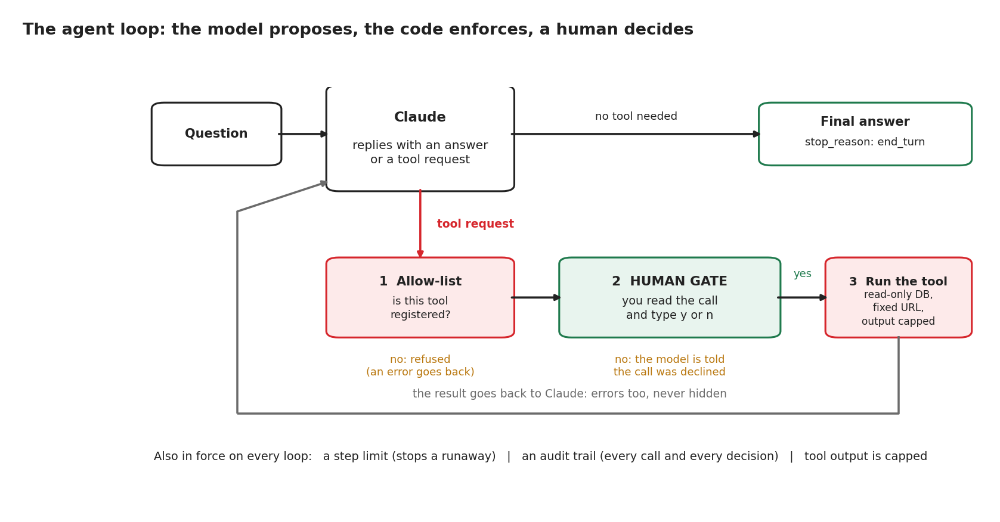

# Agentic Patterns and Workflow Integration

**Session Time:** 55 minutes (4 framing, 10 guided code read, 35 lab, 6 wrap-up and course close)

---

## Prerequisites

* Modules 1 to 3 complete, or equivalent comfort with `pytest` and reviewing generated code
* Python proficiency, including classes, dataclasses and the standard library
* No prior agent or framework experience is needed. You will read every line of the loop.

---

## Table of Contents

1. [What You Will Learn](#what-you-will-learn)
2. [What an Agent Is](#what-an-agent-is)
3. [Tools Carry Their Own Controls](#tools-carry-their-own-controls)
4. [Defence in Depth for the Database](#defence-in-depth-for-the-database)
5. [The Loop and Its Safety Controls](#the-loop-and-its-safety-controls)
6. [Propose, Do Not Act](#propose-do-not-act)
7. [Tier Approvals by Risk](#tier-approvals-by-risk)
8. [In the Lab](#in-the-lab)
9. [Wrap-Up Reflection](#wrap-up-reflection)
10. [Resources](#resources)

---

## Learning Objectives

By the end of this module, you'll be able to:

- Explain what makes a workflow agentic: a loop in which a model chooses tools
- Run and explain a function-calling agent that uses an internal API and a SQL database safely
- Layer safety controls so that no single check is the only protection
- Design an agent that proposes changes and a human who decides
- Add a human approval gate to a PR-review agent and prove it works

---

## What You Will Learn

**The challenge:** a build fails overnight. What if an agent could triage it, and you only had to approve the fix?

An **agent** is a model in a loop. You give it a question and a list of tools. It either answers or asks to use a tool; your code runs the tool and sends the result back; the loop repeats until the model answers. Nothing about that is magic, and today you will read, and then fix, the part that matters most: the code that decides what is allowed to happen.



---

## What an Agent Is

| Piece | Job |
|---|---|
| The model | Decides what to do next: answer, or request a tool |
| The tools | Ordinary functions your code exposes, each with a name, a description and an input schema |
| The loop | Runs a requested tool, sends the result back, and repeats |
| The controls | Everything in your code that limits what can happen |

The model never runs anything. It only *asks*. Your code runs the tool, which means every control you need is a control you write.

A request from the model arrives as a `tool_use` block with an id, a tool name and an input. Your reply is a `tool_result` that carries the same id, so the model knows which request you answered.

---

## Tools Carry Their Own Controls

A tool is a new thing to govern, exactly like a new data source. Treat each one the way you would treat a new endpoint.

| Tool | Control built into the tool |
|---|---|
| `query_transactions_db` | Accepts one `SELECT` and nothing else; returns at most 50 rows |
| `get_fx_rate` | The currency pair must match a fixed pattern and use known currencies, so the model cannot steer the URL; the base URL is fixed; GET only; short timeout |

The second row is worth dwelling on. Imagine a tool that took a free-text URL: the model, or a document it read, could point your service at any address. Narrow inputs are a security feature.

---

## Defence in Depth for the Database

Here is the SQL check in the lab (it is already built for you). It is the first line of defence:

```text
validate(sql):
    reject empty, None or very long input
    must START with select
    no semicolons except a last one, no comments
    none of: insert update delete drop alter create truncate replace attach
             detach pragma vacuum reindex load_extension sqlite_master ...
```

>**Be honest about what it is.**
>
>String checks can be bypassed in ways nobody has thought of yet. It is a backstop. The real control is the database refusing to write at all. In the lab the connection is switched to read-only after seeding:

```python
conn.execute("PRAGMA query_only = ON")      # from here on, this connection can only read
```

Both were tested while this module was built:

- A raw `DELETE` on the read-only connection, with no check in the way, fails with `sqlite3.OperationalError` ("attempt to write a readonly database"), and the table keeps its four rows.
- SQLite itself refuses stacked statements: `SELECT 1; DELETE ...` raises `ProgrammingError` ("You can only execute one statement at a time").

So there are four layers: the check, the read-only connection, the row cap, and a human who approves each call. Remove any one and the others still hold. In a real service the read-only connection is a database account that can only `SELECT` from approved views. The pragma is SQLite-specific.

---

## The Loop and Its Safety Controls

The loop in `agent.py` is about 40 lines. Its safety controls are all visible in one place:

| # | Control | What it prevents |
|---|---|---|
| 1 | Allow-list | The model inventing or calling a tool you never registered |
| 2 | Approval | Anything running without a human saying yes |
| 3 | Step limit | A runaway loop that never answers |
| 4 | Errors stay visible | A failed or declined call being hidden from the model, which then guesses |
| 5 | Output cap | A huge tool result flooding the model and the bill |
| 6 | Audit trail | No record of what was asked and who allowed it |

The part that enforces 1, 2, 4, 5 and 6 is `_handle_tool_call`. It is already built in the lab; your instructor reads it with you, and the tests describe each rule.

>**What the tests prove, and what they do not.**
>
>They run the loop against a scripted stand-in for the API. That proves the mechanics: approvals are requested, a declined call never runs, an approved `DELETE` is still refused, unknown tools are rejected, the loop stops at the step limit. It does **not** prove what a real model will decide to do. Only a live run, and your own review of its audit trail, shows that.

---

## Propose, Do Not Act

The safest way to let an agent help with code is to give it no tool that changes code. In the PR-review agent:

- It can **list files, read source files and read the CI report**.
- It can **propose a patch**, which only records the proposal. Nothing is written.
- A separate piece of code applies a patch, **only after a human approves**, and keeps a `.bak` of the old file.

File tools get the same care as SQL. A path guard rejects absolute paths, `..`, and symlinks that point outside the repository. The agent may read Python files, may propose changes only to Python files outside `tests/`, and cannot touch the tests at all, so it cannot make a failing test pass by editing the test.

---

## Tier Approvals by Risk

Asking a human before *every* action trains people to click yes. Ask where it matters.

| Action | Effect | Approval |
|---|---|---|
| `list_files`, `read_file`, `read_ci_report` | Reads | Free to run |
| `propose_patch` | Records a proposal only | Free to run |
| `apply_patch` | Writes to the repository | **A human decides** |

You will find a bug in the lab that makes this table false: a gate that approves everything, so the human is never asked, not even before a patch is written to disk. Spotting that, and fixing it, is the exercise.

---

## In the Lab

**Agent and PR-Review Lab.** The lab has a **core task of about 35 minutes** and a **bonus section** for anyone who finishes early or wants to keep going later. It starts from its own clean folder, so you do not need anything from an earlier module. If you get stuck, every step has a `catch-up` command that copies in finished code so you can keep going.

- **Already built for you:** `safe_sql.py` and `agent.py`, the SQL check and the agent loop.
- **Your core task:** run the function-calling agent and approve or decline each call, watch the PR-review agent apply a patch without asking anyone, fix `make_gate` (one line), then answer `n` and confirm nothing changed, and answer `y` and confirm the tests pass.
- **Bonus:** trying to get past the SQL check, reading the loop, running every test, and the discussion questions.

---

## Wrap-Up Reflection

- Which of the six loop controls would you miss most if it were removed?
- Your agent can read a customer table. What would you want to be true before it could also *write* to one?
- Where in your own team's workflow would "the agent proposes, a person approves" fit tomorrow, and where would it not?

---

## Resources

- Anthropic tool use overview: <https://docs.claude.com/en/docs/agents-and-tools/tool-use/overview>
- Anthropic Python SDK: <https://github.com/anthropics/anthropic-sdk-python>
- Python `sqlite3`: <https://docs.python.org/3/library/sqlite3.html>
- OWASP Top 10 for Large Language Model Applications: <https://owasp.org/www-project-top-10-for-large-language-model-applications/>
